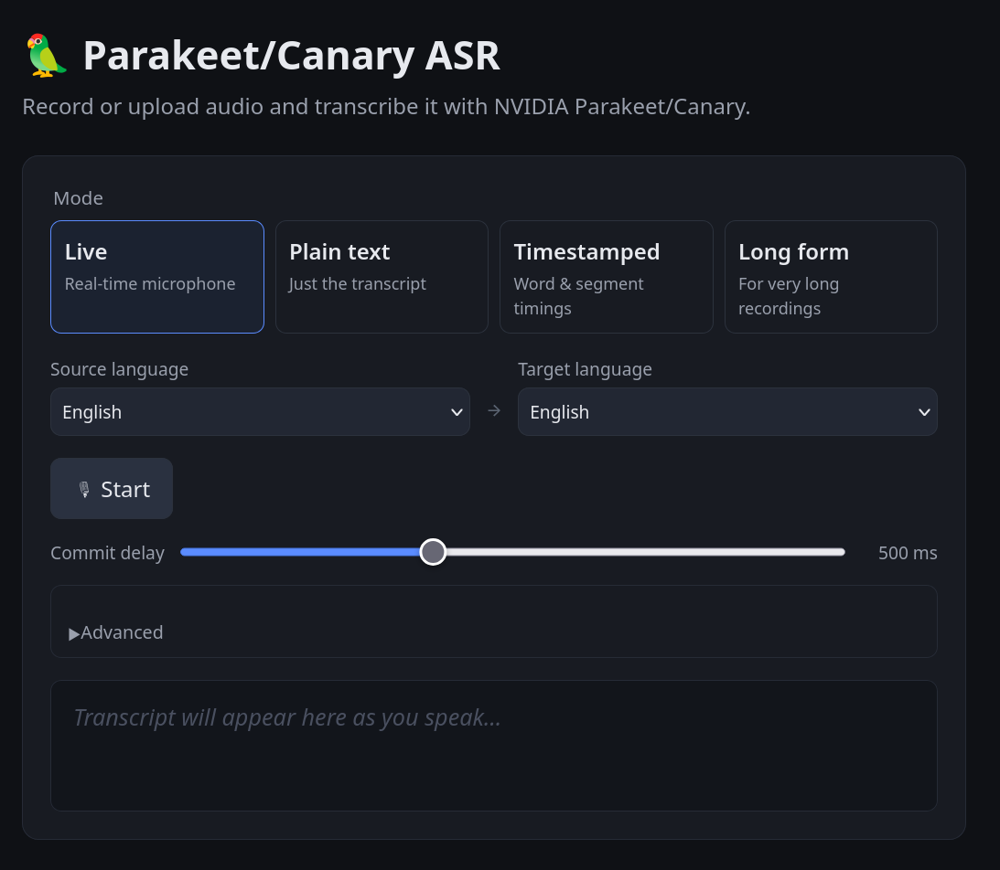

# Parakeet ASR Server

A FastAPI service that serves NVIDIA's **Parakeet/Canary** speech-to-text model, plus a Svelte frontend for
recording, uploading, and live-transcribing audio in the browser. Designed to
run on a node with NVIDIA GPUs.



```
.
├── server/      # FastAPI + NeMo API (managed with uv)
├── frontend/    # Svelte + TypeScript app (managed with Deno)
└── docker-compose.yml
```

## Features

- **Three batch transcription modes** — plain text, word/segment/char
  timestamps, and long-form (local-attention windowing for very long recordings).
- **OpenAI-compatible API** — `/v1/audio/transcriptions`, `/v1/audio/translations`
  and `/v1/models`, including **SSE streaming** (`stream=true`), so the server
  can sit behind a [LiteLLM proxy](#litellm-proxy) or be used with any OpenAI SDK.
- **Live transcription** — real-time streaming transcription over WebSocket,
  driven by client-side Silero VAD so only detected speech reaches the server.
- **Any audio in** — uploads are decoded (libsndfile, with an ffmpeg fallback
  for M4A/MP4/WebM/...), downmixed to mono, and resampled to 16 kHz.
- **Parallel requests** — one model replica is loaded per GPU; requests check
  out an idle replica from a queue, so N requests run concurrently across N GPUs.
- **Language selection & translation** — models that support it (e.g.
  `nvidia/canary-1b-v2`) accept `source_lang` / `target_lang`; setting them to
  different values performs speech translation.

## UI overview

The frontend is a single card with four mode tabs:

| Tab | Description |
| --- | ----------- |
| **Live** | Real-time mic transcription with Silero VAD activity meter |
| **Plain text** | Record or upload → plain transcript |
| **Timestamped** | Record or upload → transcript + word/segment timings |
| **Long form** | Record or upload → long-form transcript |

Language selectors (source → target) appear at the top when the loaded model
supports them; they are disabled while live transcription is active.

### Live transcription

The Live tab uses the [Silero VAD](https://github.com/ricky0123/vad) browser
library (ONNX Runtime Web, v5 model) to detect voice activity locally:

1. Click **Start** — the ONNX model is loaded (one-time, ~2 s) and a WebSocket
   connection is opened to `/v1/transcribe/stream`.
2. The VAD runs on every audio frame (512 samples / 32 ms) and shows a
   **probability meter** that fills green→red as speech likelihood rises. A
   pulsing dot indicates active speech.
3. Only frames where speech is detected are forwarded to the server as
   PCM-16 / 16 kHz binary WebSocket frames; silent intervals are dropped.
4. The server streams back `partial` events (shown in italic grey) and
   `committed` events (appended to the permanent transcript) in real time.
5. When the VAD detects that the user has stopped speaking it waits for the
   **commit delay** (configurable slider, 200 – 1 000 ms, default 500 ms) and
   then sends `{type: "end"}` to the server. The server finalises the current
   segment, emits a `final` event, and closes the connection. The client
   silently reopens the WebSocket for the next utterance.
6. The status label cycles through: **Listening…** → **Speaking…** →
   **Committing… (N ms)** → **Listening…**
7. Click **Stop** to end the session.

## API

| Method | Path | Description |
| ------ | ---- | ----------- |
| `GET`  | `/health` | Readiness, worker count, language capabilities |
| `POST` | `/v1/transcribe` | Plain-text transcription |
| `POST` | `/v1/transcribe/timestamps` | Word / segment / char timestamps |
| `POST` | `/v1/transcribe/longform` | Long-form transcription |
| `WS`   | `/v1/transcribe/stream` | Real-time streaming transcription |
| `POST` | `/v1/audio/transcriptions` | OpenAI-compatible transcription (+ SSE streaming) |
| `POST` | `/v1/audio/translations` | OpenAI-compatible translation to English |
| `GET`  | `/v1/models` | OpenAI-compatible model list |

`POST` endpoints take `multipart/form-data` with a `file` field (any common
audio format).

```bash
curl -F file=@sample.wav http://localhost:9000/v1/transcribe
curl -F file=@sample.wav http://localhost:9000/v1/transcribe/timestamps
curl -F file=@sample.wav http://localhost:9000/v1/transcribe/longform
```

### OpenAI-compatible endpoints

`POST /v1/audio/transcriptions` accepts the standard OpenAI fields:

| Field | Notes |
| ----- | ----- |
| `file` | Required. Any format libsndfile or ffmpeg can decode |
| `model` | Accepted and ignored (the server runs one model) |
| `language` | ISO-639-1 code (`en`, `sk`, `en-US` is fine). Selects the source language on Canary; ignored on models without language selection |
| `response_format` | `json` (default), `text`, `verbose_json`, `srt`, `vtt` |
| `timestamp_granularities[]` | `word` and/or `segment` (for `verbose_json`) |
| `stream` | `true` → server-sent events (see below) |
| `prompt`, `temperature` | Accepted and ignored |
| `target_language` | Extension: translate into this language (Canary) |
| `longform` | Extension: local-attention mode for very long recordings |

`POST /v1/audio/translations` is the same minus streaming/timestamps, always
targets English, and takes the source via `language` (default `en`).

Errors on these routes use the OpenAI envelope
(`{"error": {"message", "type", "param", "code"}}`) so OpenAI SDKs and LiteLLM
surface the real message.

```bash
curl http://localhost:9000/v1/audio/transcriptions \
  -F file=@sample.m4a -F model=parakeet -F language=sk
```

#### SSE streaming (`stream=true`)

With `stream=true` (and `response_format` `json`/`text`; it is ignored for the
timestamped formats, as on OpenAI) the response is `text/event-stream` in
OpenAI's `gpt-4o-transcribe` format:

```
data: {"type":"transcript.text.delta","delta":"Hello there."}

data: {"type":"transcript.text.delta","delta":" How are you?"}

data: {"type":"transcript.text.done","text":"Hello there. How are you?"}
```

Parakeet/Canary are not incremental models, so the audio is split into chunks
of at most `SSE_CHUNK_DURATION` seconds, cut at the quietest point near the
limit. Each chunk is transcribed in turn and emitted as one delta, so the first
text arrives after one chunk rather than after the whole file. An error after
the stream has started is sent as a `data: {"error": {...}}` event, which the
OpenAI SDKs raise as an exception.

```python
from openai import OpenAI

client = OpenAI(base_url="http://localhost:9000/v1", api_key="unused")
with open("sample.wav", "rb") as f:
    for event in client.audio.transcriptions.create(
        model="parakeet", file=f, stream=True
    ):
        if event.type == "transcript.text.delta":
            print(event.delta, end="", flush=True)
```

`scripts/test_sse.py` does the same from the command line.

### LiteLLM proxy

[`litellm/config.yaml`](litellm/config.yaml) is a ready-to-use example. It
exposes the server in two ways:

1. **As a regular model** (`model_name: parakeet`, provider `openai/` with
   `api_base` pointing at this server). Clients call LiteLLM's standard
   `POST /v1/audio/transcriptions` with `model=parakeet` and get keys,
   budgets, logging, load balancing and health checks (`mode:
   audio_transcription`). All response formats work. LiteLLM sends
   `response_format=verbose_json` by default so that it can read `duration`
   for cost tracking.
2. **As a pass-through route** (`/parakeet/...` → this server, with LiteLLM
   key auth). This is how SSE streaming and the native endpoints reach clients
   through LiteLLM, e.g. `base_url="http://litellm:4000/parakeet/v1"`.

```bash
litellm --config litellm/config.yaml --port 4000
curl http://localhost:4000/v1/audio/transcriptions \
  -H "Authorization: Bearer sk-change-me" -F model=parakeet -F file=@sample.wav
```

> **Streaming caveat (LiteLLM ≤ 1.105.1, tested):** LiteLLM's own
> `/v1/audio/transcriptions` route does not stream. It drops `stream` and
> returns the complete JSON response. Its pass-through route forwards the SSE
> events intact (the OpenAI SDK's `stream=True` works through it), but for
> `multipart/form-data` uploads it buffers the upstream response, so all the
> deltas arrive together when transcription finishes. For truly progressive
> streaming, call the server directly. The WebSocket live endpoint is not
> proxied by LiteLLM either; expose it directly or through a plain reverse
> proxy.

### WebSocket streaming protocol

Connect to `/v1/transcribe/stream` (optional `?source_lang=…&target_lang=…`).

**Client → server**

| Frame | Content |
| ----- | ------- |
| Binary | PCM-16 mono 16 kHz audio samples (`Int16Array`) |
| Text | `{"type": "end"}` — signals end of stream, triggers final commit |

**Server → client**

| Event type | When emitted |
| ---------- | ------------ |
| `partial` | In-progress hypothesis, may still change |
| `committed` | Stable prefix confirmed across `STREAM_STABLE_ITERS` inference runs |
| `final` | Last segment after `{"type": "end"}` received |

All events carry `{type, text, start, id}`.

### Source / target language (model-dependent)

```bash
# transcribe German speech
curl -F file=@de.wav -F source_lang=de -F target_lang=de \
  http://localhost:9000/v1/transcribe
# translate German speech to English
curl -F file=@de.wav -F source_lang=de -F target_lang=en \
  http://localhost:9000/v1/transcribe
```

Whether language selection is available is reported by `GET /health`
(`supports_languages` + `languages` list); the UI shows the pickers only when
the model supports them. Supplying these fields to a model that does not support
them returns `400`.

## Quick start (Docker Compose)

Requires Docker with the NVIDIA Container Toolkit.

```bash
cp .env.example .env        # optional — tweak model, worker count, etc.
docker compose up --build
```

- API & docs: http://localhost:9000/docs
- Frontend:   http://localhost:5173

The first boot downloads the model weights (cached in the `model-cache` volume).

### Live-reload development

```bash
docker compose watch
```

- Changes to `frontend/src` hot-reload via Vite HMR.
- Changes to `server/app` sync and restart the API.
- Changes to `pyproject.toml` / `package.json` / `deno.json` trigger a full
  rebuild.

> **Note — VAD assets**: the first time you run `deno task dev` (or `docker
> compose watch`) the `copy-assets` step copies four files from `node_modules`
> into `frontend/public/`: the Silero VAD v5 ONNX model, the ONNX Runtime WASM
> binary, and the AudioWorklet bundle. These are listed in `.gitignore` and
> regenerated automatically; do not commit them.

## Production image (single container)

`prod.Dockerfile` is a multi-stage build that compiles the Svelte frontend
(including the VAD asset copy step) and bakes the result into the server image.
FastAPI then serves the static UI **and** the API from a single port.

```bash
# build from the repo root
docker build -f prod.Dockerfile -t parakeet-asr:prod .

# run (needs the NVIDIA Container Toolkit)
docker run --gpus all -p 9000:9000 \
  -v /models/huggingface:/cache/hf -v /cache/torch:/cache/torch \
  parakeet-asr:prod
```

Or use the production compose file:

```bash
docker compose -f docker-compose.prod.yml up --build -d
```

Open http://localhost:9000 — UI and API on the same origin.

## Running without Docker

### Server (uv)

```bash
cd server
uv sync
uv run uvicorn app.main:app --host 0.0.0.0 --port 9000
```

### Frontend (Deno)

```bash
cd frontend
deno install          # install npm deps via Deno's node_modules compat
deno task dev         # copies VAD assets then starts Vite — http://localhost:5173
# deno task build     # copies VAD assets then builds production bundle → dist/
# deno task check     # Svelte + TypeScript type-check
```

## Configuration

### Server environment variables

| Variable | Default | Meaning |
| -------- | ------- | ------- |
| `MODEL_NAME` | `nvidia/canary-1b-v2` | HuggingFace model ID to load |
| `NUM_WORKERS` | `0` (one per GPU) | Number of model replicas |
| `DEVICES` | _(auto)_ | Explicit device list, e.g. `cuda:0,cuda:1` |
| `MAX_UPLOAD_MB` | `200` | Max batch upload size |
| `LONGFORM_CONTEXT` | `256` | Local-attention context for long-form mode |
| `STREAM_MIN_DURATION` | `1.0` | Seconds of audio before first streaming inference |
| `STREAM_RETRANSCRIBE_INTERVAL` | `0.5` | Min new audio (s) between inference runs |
| `STREAM_STABLE_WORDS` | `4` | Min prefix length (words) required for a commit |
| `STREAM_STABLE_ITERS` | `2` | Identical-prefix runs needed before committing |
| `STREAM_MAX_DURATION` | `30.0` | Hard buffer cap (s) that forces a commit |
| `STREAM_CONTEXT_DURATION` | `3.0` | Context window (s) prepended to each inference |
| `SERVED_MODEL_NAME` | _(= `MODEL_NAME`)_ | Model id reported by `GET /v1/models` |
| `SSE_CHUNK_DURATION` | `20.0` | Max audio (s) per chunk/delta for `stream=true` |
| `SSE_SPLIT_SEARCH` | `4.0` | Window (s) before the chunk limit searched for a quiet cut point |
| `LOGFIRE_TOKEN` | _(unset)_ | Export traces to Logfire; console-only if unset |

### Frontend environment variables

| Variable | Default | Meaning |
| -------- | ------- | ------- |
| `API_PROXY_TARGET` | `http://localhost:9000` (host) / `http://server:9000` (compose) | Backend address the Vite dev server proxies `/v1` and `/health` to |
| `VITE_API_BASE` | _(unset)_ | Override to call a different API origin directly from the browser |

The browser always calls the API at the same origin the page was loaded from.
The Vite proxy makes this work seamlessly in development.

## Observability

Logging and tracing use [Logfire](https://logfire.pydantic.dev/). FastAPI is
instrumented (one span per request), each transcription and streaming session
runs inside its own span, and stdlib logging (uvicorn, NeMo) is routed through
Logfire as well. Set `LOGFIRE_TOKEN` to export to the Logfire backend.

## Notes

- Each replica is pinned to a GPU and switches to local attention only while
  serving a long-form request, then restores the default attention config.
- GPU assignment in Compose uses `deploy.resources.reservations.devices`; with
  multiple GPUs the default loads one replica per GPU. Set `NUM_WORKERS` to cap
  that.
- The Silero VAD runs entirely in the browser (AudioWorklet thread) using ONNX
  Runtime Web in single-threaded mode — no Cross-Origin-Isolation headers
  required. Inference on 512-sample (32 ms) frames is well within real-time
  budget even on modest hardware.
